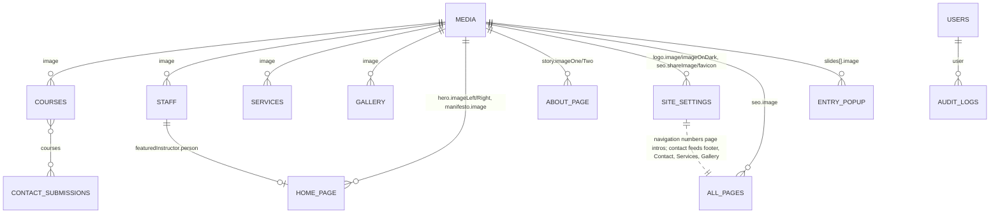

# Database map

Payload CMS on MongoDB. 9 collections + 9 globals. Every field below is rendered by `sm-fe`
(column **Used by**), except the admin-only System collections. If you add a field, add it here
and to `sm-fe/lib/types.ts` (plus its copy in `sm-be/src/seed/types.ts`).

Raw MongoDB collection names differ from slugs for two collections: `staff` → `staffs`, `gallery` → `galleries`.

## Relationships

## Collections

Drag-and-drop ordered (`orderable`) collections expose a hidden `_order`; the website sorts by it and
derives every "01, 02…" number from position, so there are no hand-typed number fields.

### Academy

**courses** · `/courses`, `/courses/[slug]`, home course list, contact form
| Field | Type | Used by |
| --- | --- | --- |
| title | text | everywhere |
| slug | text, unique, auto from title | URLs, `?course=` prefill |
| accent | red \| black | catalog block, detail hero, list hover, form chip |
| level | text | catalog label, detail hero, home list |
| summary | textarea | catalog, detail hero, page meta description |
| image → media | upload | catalog, detail hero, home list (alt from Media) |
| imageCaption | text | catalog photo tag, detail hero |
| duration, classSize | text | spec tables, sticker, enrol strip, form |
| nextIntake, location | text | catalog spec, enrol strip |
| schedule | textarea (lines) | enrol strip |
| price, promotionPrice? | text | everywhere a price shows (promo crosses out regular) |
| syllabus[] { title, description? } | array | detail syllabus (a lesson with a description opens; without one it is a plain row). `npm run update:courses` refreshes level, duration, class size and syllabus from the Website Brief sheet |

**staff** (label: Instructors) · `/staffs`, `/staffs/[slug]`, home featured instructor
| Field | Type | Used by |
| --- | --- | --- |
| name, shortName, slug | text | cards, profile, "Meet {shortName}", next-up |
| role, note | text | card, profile hero, featured block |
| image → media | upload | card, profile, featured, next-up |
| quote | textarea | profile quote, featured block |
| bio[] { paragraph } | array | profile bio |
| teachingFocus | textarea | profile practice |
| specialties[] { item } | array | profile practice, featured chips |
| favoritePour | text | profile "off duty" card |
| achievements[] { year, title, organization } | array | profile achievements |

**services** · `/services` — title, label, copy, image → media.

**testimonials** · home carousel — quote, author, role. *(Moved out of the old site-content global.)*

### Leads

**contact-submissions** · written by the `/contact-us` form
| Field | Type | Notes |
| --- | --- | --- |
| name, phone | text | |
| courses → courses | relationship, hasMany, min 1 | was an array of slugs |
| message | textarea | |

### Library

**media** — upload (`card` 800×1000, `wide` 1600×1000) + `alt` (required). The `alt` is the single source of
image descriptions site-wide; the old per-place `imageAlt` fields were removed.

**gallery** · `/gallery` — image → media, caption.

### System (admin only)

**users** — auth (email, password) + name, role (`super-admin` \| `editor` \| `staff`, saved to JWT).
**audit-logs** — action, resourceType, resource, documentId, documentTitle, changedFields[], user → users, userEmail, createdAt.

## Globals

`intro` on every inner page is `{ eyebrow, title, copy, accent: red|black }`; its big number comes from the
page's position in Site settings → navigation.

Every page global (group "Pages"), course and staff member also has an optional
`seo { title?, description?, image?, noIndex }`. Empty values fall back to the page's own content, then to
Site settings → seo.

| Global | Fields | Page |
| --- | --- | --- |
| **site-settings** | announcementBar { enabled, message, linkLabel?, linkHref? } · navigation[] { label, href } · headerCta { label, href } · contact { address, mapUrl, email, phone, hours } · social { handle, url } · footer { tagline, headline, ctaLabel, addressLabel, contactLabel, linksLabel, copyright } · logo { image?, imageOnDark? } · seo { siteName, description, shareImage, siteUrl?, keywords?, favicon?, noIndex } · theme { white, black, red } (hex) | header, footer, `<head>` meta, favicon, robots.txt, sitemap.xml, CSS colour variables; contact/social reused by Contact, Services, Gallery |
| **home-page** | hero { kickerLeft, kickerRight, titleLineOne, titleWord, titleEmphasis, titleLineThree, summary, buttonLabel, imageLeft, imageRight, burst, note } · marquee · manifesto { eyebrow, title, copy, image, stamp, linkLabel } · featuredInstructor { eyebrow, title, person → staff, linkLabel } · featuredCourses { eyebrow, title, linkLabel } · testimonials { eyebrow } | `/` |
| **about-page** | intro · story { eyebrow, title, copy, imageOne, imageTwo, imageOneCaption, stamp } · marquee · values { title, items[] { title, copy } } | `/about` |
| **courses-page** | intro · catalog { viewCourseLabel, stickerLabel } · marquee · faq { eyebrow, title, items[] { question, answer } } · help { eyebrow, title, linkLabel } · detail { backLabel, durationLabel, tuitionLabel, classSizeLabel, reserveLabel, syllabusEyebrow, syllabusTitle, syllabusCopy, intakeLabel } | `/courses`, `/courses/[slug]`, home list labels |
| **team-page** | intro · cardLinkLabel · note { eyebrow, title, copy, linkLabel } · profile { backLabel, profileLabel, stamp, bioLabel, achievementsEyebrow, achievementsTitle, practiceEyebrow, practiceTitle, offDutyLabel, favoritePourLabel, nextLabel } | `/staffs`, `/staffs/[slug]` |
| **services-page** | intro · itemLinkLabel · banner { eyebrow, title } | `/services` |
| **gallery-page** | intro · graffiti · social { copy } | `/gallery` |
| **contact-page** | intro · panels { visitTitle, visitLinkLabel, emailTitle, emailNote, phoneTitle } · form { eyebrow, title, nameLabel, phoneLabel, coursesLabel, messageLabel, messagePlaceholder, submitLabel, successTitle, successCopy } | `/contact-us` |
| **entry-popup** | enabled · dismissLabel · slides[] { active, displayMode: image\|video, title, eyebrow?, copy?, image?, ctaLabel?, ctaHref?, videoUrl? } | every page, once |

Multi-line text fields (`burst`, `note`, `stamp`, `schedule`, `address`, `hours`, `graffiti`) use one line per row.

## What changed from the old schema

| Old | New | Why |
| --- | --- | --- |
| `site-content` (one 10-tab global) | 7 page globals + `entry-popup` | Each page's copy lives with its page. |
| `pageIntros[]` with `page` select + `index` | `intro` group on each page global | No lookup by name; number derived from nav. |
| `marquees { home, about, courses }` | `marquee` on each page | Same reason. |
| `homeTestimonials[]` (exactly 10) | `testimonials` collection | Any count, reorderable, own permissions. |
| `courses.index`, `services.number`, `aboutValues[].number`, `contactDetails[].number` | removed | Numbers come from order. |
| `courses.imageAlt`, `story.imageOneAlt/imageTwoAlt`, popup `imageAlt` | `media.alt` | One description per image. |
| `courses.tone` (CSS string) | `courses.accent` (select: red \| black) | Editors can't break styling. |
| `syllabus[] { item }` + global `firstLessonCopy`/`lessonCopy` | `syllabus[] { title, description? }` | Each lesson can have its own text; no shared filler. |
| `footer.address/email/phone`, `contactDetails[]`, `servicesBanner.email`, `gallerySocial.handle/href` | `site-settings.contact` + `social` | One source of contact truth. |
| `footer.links[]` | reuses `navigation` | Was a duplicate. |
| `theme { background, foreground, accent, cobalt, acid }` (unused) | `theme { white, black, red }` (hex) | The site uses only black, white and red; the theme now drives them. |
| `entryPopup` promotion fields + `additionalSlides[]` | `slides[]` | One slide model. |
| `homeHero.burstTop/burstBottom`, `noteLineOne/Two`, `stampTop/stampBottom` | `burst`, `note`, `stamp` (multi-line) | Fewer fields. |
| `contact-submissions.courses[] { slug }` | relationship → courses | Real links in the admin. |
| — | `users.role`, `audit-logs` | Permissions and history. |
